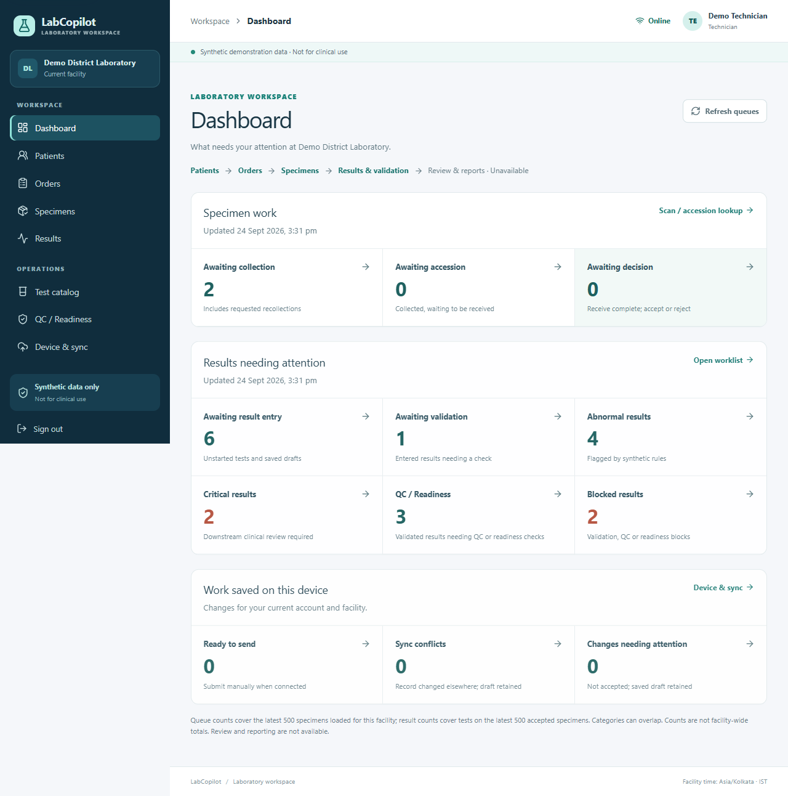
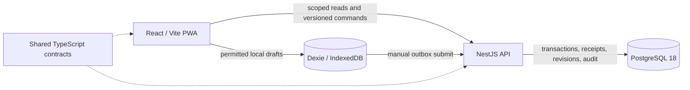

# LabCopilot

**One team. One clear laboratory workflow.**

LabCopilot is a local-first laboratory portal prototype inspired by the needs of government hospital labs: keep the patient, order, specimen, accession, and result connected, even when connectivity is unreliable. It is an engineering demonstration built entirely with **synthetic data**. It is **not for clinical use**.

The working slice runs from patient registration through analytical readiness. The larger vision includes qualified human review, approved clinician and patient reports, governed AI assistance, notifications, interoperability, instruments, inventory, and public-health analytics. Those capabilities remain on the [product roadmap](docs/Product-Specification.md); they are not presented as working features.



## What works today

| Workflow | Current demonstration |
| --- | --- |
| Patient and order | Facility-scoped synthetic patients; test and panel catalog; linked, versioned orders with frozen test membership and synthetic rule inputs |
| Specimen and accession | Collection, receipt, acceptance and rejection; distinct recollection attempts, stable identifiers, exact historical accession lookup and event history |
| Analytical result | Typed numeric/text/coded entry; exact decimal storage; deterministic synthetic validation, abnormal/critical flags, manual QC attestation and analytical-readiness gate |
| Evidence and access | Role and facility checks on the server; idempotent versioned commands; revision and mutation audit history |
| Work through interruptions | Scoped IndexedDB drafts and command outbox for supported actions, manual submit, pending/conflict states, and an installable app shell |

The QR-style artwork is illustrative; it is not a scannable label. Critical flags do not send alerts. QC is a demo attestation, not instrument control measurement. **Analytical readiness is not clinical approval or report release.** See the [product specification](docs/Product-Specification.md) and [architecture](docs/Architecture.md) for the precise boundary.

## Run the demo locally

Use **Node.js 24–26** and **pnpm 11.19.0**. Run commands from `source/`, the pnpm workspace root:

```powershell
cd source
pnpm install --frozen-lockfile
pnpm setup:local
pnpm db:start
pnpm db:generate
pnpm db:migrate
pnpm db:seed
pnpm dev
```

`pnpm db:start` uses the bundled PostgreSQL runtime on **Windows**. On macOS/Linux, replace that step with PostgreSQL 18 via Docker Compose after `pnpm setup:local`:

```sh
docker compose --env-file .env -f infra/compose.yaml up -d
docker compose --env-file .env -f infra/compose.yaml exec postgres createdb -U labcopilot labcopilot_test
```

The second Docker command creates the isolated test database once. Use an existing PostgreSQL 18 server instead if preferred, with `DATABASE_URL` and `TEST_DATABASE_URL` in your private `source/.env`. The setup script creates that ignored file with random development credentials and preserves it on later runs. Never commit it or put real patient data in this app.

Open **[http://localhost:5173](http://localhost:5173)**. The API runs on `127.0.0.1:3001`; its OpenAPI page is [http://127.0.0.1:3001/api/docs](http://127.0.0.1:3001/api/docs). Sign in with a seeded username below and the locally generated `DEMO_PASSWORD` from `source/.env`. Re-seeding changes password hashes and invalidates existing sessions.

| Username | Demo role | Useful view |
| --- | --- | --- |
| `clerk` | Registration clerk | Patients, orders, collection and accession |
| `technician` | Technician | Specimens, result entry, validation and QC/readiness |
| `approver` | Qualified approver | Read-only laboratory evidence; approval is not implemented |
| `admin` | Administrator | Configuration only; no inherited clinical authority |
| `other-clerk` | Second-facility clerk | Facility-isolation demonstration |

## Five-minute walkthrough

1. Sign in as `clerk` and open **Demo Patient 001**. Create an order for **Glucose (demo)**, generate its specimen, record collection, receive it to create an accession, then accept it. Inspect the specimen timeline and its current accession identifier.
2. Sign in as `technician`, open that specimen's results, and enter a synthetic value. Save the draft on the device, open **Device & sync**, and **Submit pending**. Mark it entered, validate it, record a *synthetic* QC pass with a reason, and check analytical readiness. The result page shows its flags, revisions, and audit evidence.
3. Sign in as `approver` to inspect the result without write controls. Sign in as `admin` to see the separate configuration workspace. `other-clerk` belongs to a different demo facility.

For the interruption path, keep an authenticated result page open, go offline, save a supported correction draft, reconnect, and manually submit it. Server-only validation, QC and readiness require a connection. An offline page reload or expired session may require online sign-in; this is not complete two-way synchronization.

To demonstrate traceability, create another specimen, reject it with a synthetic reason and request recollection. Open its order and generate a replacement specimen. After collecting and accepting the replacement, look up the first accession: its rejected decision and original collection attempt remain visible. Creating the replacement requires a connection.

## How it is built



The repository uses TypeScript, React 19, Vite, NestJS 11, Prisma, PostgreSQL 18, Dexie, Zod, Vitest, React Testing Library, and Playwright. GSAP adds small entrance transitions with reduced-motion support. Domain decisions and authorization remain server-side. The [architecture](docs/Architecture.md) explains the intended boundaries for future review, AI, reporting, and FHIR/HL7 exchange.

## Verification and limits

From `source/`, run `pnpm typecheck`, `pnpm build`, and `pnpm test` after setup and database migration. `pnpm test:e2e` runs the browser workflow against a built preview and a live local API. It uses installed Microsoft Edge by default on Windows; on Linux, install Chromium first with `pnpm exec playwright install --with-deps chromium`. `pnpm check:secrets` runs the focused repository scan. [GitHub Actions CI](.github/workflows/ci.yml) is configured to run typecheck, build, tests, the secret scan, and Chromium E2E against disposable PostgreSQL on Ubuntu.
 
Development authentication and the current synthetic rules are not production or clinical policies. There is no qualified release workflow, generated report, delivered critical notification, AI interpretation, FHIR/HL7 exchange, reviewed LOINC map, measured QC, instrument integration, or full offline sync yet. The API intentionally rejects production authentication mode. The [original vision](docs/LabCopilot_Original_Buildathon_Spec.pdf.pdf) is preserved in the [product specification](docs/Product-Specification.md), which separates demonstrable behavior from the remaining work.
