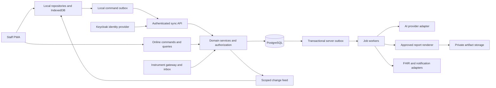
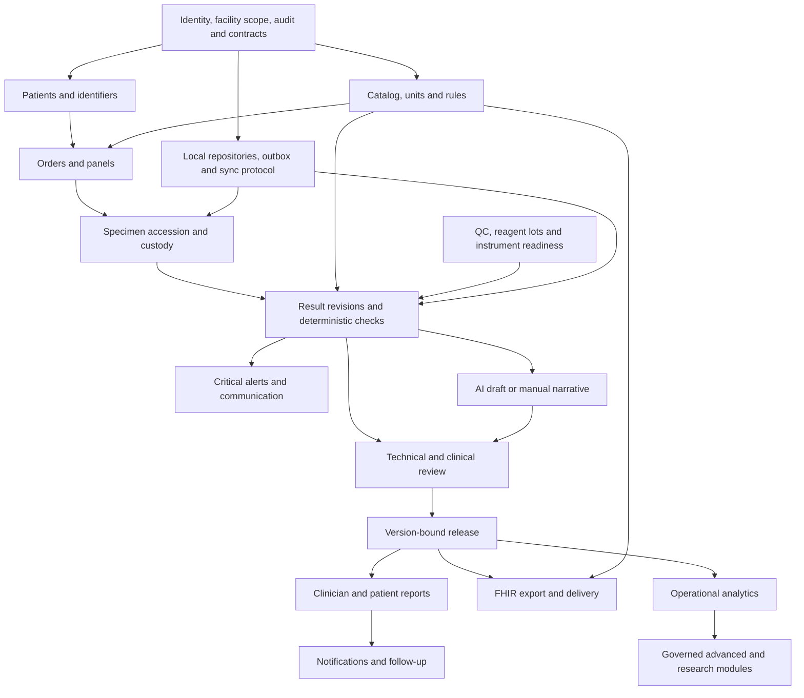

# LabCopilot architecture blueprint

Date: 2026-09-19; Phase 3 status update: 2026-09-23; workflow UX update: 2026-09-24. Status: recommended full-product design with verified synthetic foundation, pre-analytical and analytical subsets. This document specifies intended behavior beyond those subsets and does not imply clinical validation or production readiness.

Read with [Product-Specification.md](Product-Specification.md) for scope, capability classifications, roles and screens, and [PROJECT_STATE.md](PROJECT_STATE.md) for the observed repository state and build sequence. The source is [the original ten-page specification](LabCopilot_Original_Buildathon_Spec.pdf.pdf), read completely with AGENTS.md. The supplied filename ends in `.pdf.pdf`; it is preserved unchanged.

## 1. Architecture decisions and rationale

| Decision | Recommendation and reason | Consequences / source clarification |
| --- | --- | --- |
| AD-01: Application shape | React PWA and a NestJS modular monolith with a separately running worker from the same codebase | One domain model, transaction boundary and deployment path for a solo build. Modules can split later if measured load requires it; no initial microservice network. |
| AD-02: Canonical data | PostgreSQL relational clinical/workflow records with immutable revisions | The source's central FHIR store becomes an interoperability boundary. FHIR is an exchange representation, not the permissions, sync or workflow engine. |
| AD-03: Local operation | Dexie/IndexedDB local working set plus atomic command outbox, Workbox app-shell caching and custom synchronization | Preserve offline work while handling conflicts, eviction, suspended browsers, stale permissions and interrupted transfers explicitly. |
| AD-04: Server authority | Server validates permissions, state transitions, rules, versions and release in transactions | The server does substantially more than storing synced data. Browser validation improves feedback but cannot authorize release. |
| AD-05: Clinical separation | Measurements, deterministic evaluations, AI drafts, review decisions and released reports are separate entities | LLM output cannot mutate measurements, alter thresholds, acknowledge alerts, approve reports or order tests. |
| AD-06: Human release | Qualified, explicitly authorized reviewer approves exact versions; final release requires server connectivity | Resolves auto-release versus mandatory human review. Later deterministic auto-verification requires a separately validated policy and remains disabled initially. |
| AD-07: Identity | Keycloak OIDC with server-managed sessions; facility/action/record-scope authorization in LabCopilot | Identity provider roles alone do not grant clinical authority. Administrative access does not imply result approval. |
| AD-08: Asynchronous work | Transactional database outbox and pg-boss workers; idempotent handlers | Durable jobs for AI, report rendering, notifications and exchange without adding Redis initially. Delivery can repeat; business effects must not. |
| AD-09: External dependencies | Explicit adapters for AI, object storage, notifications, terminology and instruments | Each adapter declares real, simulated, unavailable or failed mode. Simulated delivery is never reported as actual delivery. |
| AD-10: Deployment | Single-facility synthetic demo first; same containers can run on an approved hospital LAN or hosted environment | Facility IDs and scoped queries exist from the start. Disconnected multi-server replication is a later architecture phase, not implied by PWA sync. |
| AD-11: Standards target | FHIR R4 4.0.1 export subset and reviewed LOINC/UCUM mappings | Full FHIR server, ABDM exchange and vendor analyzer compatibility require additional contracts and validation. |
| AD-12: Delivery evidence | Classify scope separately from implementation and testing status | A one-week demo does not establish readiness for clinical deployment or accreditation. |

No existing application architecture is being replaced. These choices resolve alternatives in the source (React/Vue, Node/Python, REST/GraphQL, Dexie/PouchDB) into a single buildable baseline. Changes to these decisions must record rationale, affected modules, migration impact and tests in this document and PROJECT_STATE.md.

## 2. Recommended final stack

| Layer | Selected technology | Intended use |
| --- | --- | --- |
| Language/runtime | TypeScript, Node.js 24 LTS, pnpm workspace | Shared contracts and pure rules, one application language. Use a current supported patch compatible with selected tooling. |
| Web application | React, Vite, React Router | Client-rendered authenticated application; route-level splitting and protected navigation. |
| UI | Tailwind CSS, shadcn/ui built on Radix primitives, TanStack Table, React Hook Form, Zod | Consistent tokens, keyboard-accessible components, laboratory tables and validated forms. Accessibility still requires testing. |
| UI motion | GSAP | Presentation-only entrance transitions with reduced-motion support; no animation of laboratory measurements or clinical flags. Existing custom React/CSS components remain the implemented UI. |
| Localization/charts | i18next, Noto fonts, Recharts | English/Hindi foundation; regional language packs and clinically reviewed translations later. |
| Local data/PWA | Dexie over IndexedDB, Workbox through Vite PWA integration | Reactive local repositories, app-shell caches and shared sync engine. Do not add a second offline database or Workbox mutation queue. |
| Backend | NestJS, REST JSON, OpenAPI | Typed modular domain services and generated API client. No GraphQL layer initially. |
| Database | PostgreSQL 18, Prisma ORM and migrations | Relational integrity, transactions, decimal values and versioned data. Reviewed SQL migrations handle constraints not expressible through the ORM. |
| Jobs | pg-boss with a transactional outbox relay | Durable asynchronous work, delayed escalation, bounded retries and dead-letter operations. |
| Authentication | Keycloak OIDC, Authorization Code with PKCE, NestJS session/BFF endpoints | IdP handles credentials/MFA; browser holds a secure session cookie, not persistent bearer tokens. |
| AI | Server-only OpenAI Responses API adapter with strict structured outputs; adapter supports a later on-premises provider | Model ID/prompt/schema are configuration pinned after synthetic evaluation. No hardcoded claim that the PDF's GPT-4 is the required model. |
| Reports | Approved HTML templates rendered to PDF by Playwright/Chromium in worker | Deterministic tables and figures from approved snapshots; embedded fonts for Hindi; separate clinician/patient audiences. |
| Files | Object-storage interface with local private volume for demo, S3-compatible encrypted storage for deployment | Private immutable report artifacts, restricted instrument payloads and evidence files. PostgreSQL holds metadata/hashes. |
| Interoperability | Explicit TypeScript FHIR R4 mappings, official HL7 validator in CI, isolated HL7 v2/vendor gateway later | Test mappings and destination profiles independently of internal persistence. HAPI FHIR is optional when a real full-server use case exists. |
| Testing | Vitest, React Testing Library, API integration tests against PostgreSQL, Playwright, axe | Domain invariants, authorization, sync failures, end-to-end workflows and accessibility. |
| Delivery/operations | Docker Compose, reverse proxy with HTTPS, CI through GitHub Actions after a remote exists, structured logs/OpenTelemetry | Reproducible demo, migrations, health checks, backups and operational visibility. No deployment has occurred. |

Pin exact package versions and container digests with a compatibility smoke test during foundation work; there is no lockfile today. Node 24 is a supported LTS choice, and PostgreSQL 18 is a supported major line. Dependency patch numbers must be checked again when installed. [Node release policy](https://nodejs.org/en/about/previous-releases), [PostgreSQL version policy](https://www.postgresql.org/support/versioning/), [Nest prerequisites](https://docs.nestjs.com/first-steps), [Prisma requirements](https://docs.prisma.io/docs/orm/reference/system-requirements), [Vite guide](https://vite.dev/guide/).

The recommendation favors a static PWA because the primary interface is an authenticated local laboratory workspace. NestJS provides module boundaries without a second language; a separate Python research service can be introduced for validated models later. Dexie is a storage wrapper, not automatic synchronization. pg-boss supplies PostgreSQL-backed jobs; our outbox and idempotency rules remain application responsibilities. [Dexie documentation](https://dexie.org/docs), [pg-boss](https://github.com/timgit/pg-boss).

## 3. System and trust boundaries



The diagram is an intended architecture, not a deployed topology. The browser, imported messages, AI output and external responses are untrusted inputs. Domain services form the authorization and invariant boundary. AI receives only permitted input snapshots and returns candidates; it has no database credentials or clinical command tools.

## 4. Frontend architecture

Proposed layout under the existing empty `source/` directory (none of these files exist yet):

```text
source/
  apps/
    web/src/
      app/                 routing, providers, shell, route boundaries
      features/            dashboard, patients, orders, specimens, results,
                           reviews, reports, alerts, sync, quality, inventory,
                           instruments, interoperability, analytics, governance
      components/          shared tables, forms, dialogs, timeline, state badges
      data/                local schema, repositories, projections, migrations
      sync/                command queue, transport, retry, conflict resolution
      i18n/                reviewed UI language resources
      pwa/                 service worker and cache/update policy
    api/src/modules/       domain modules listed below
    worker/src/            job bootstrapping using the same domain packages
  packages/
    contracts/             schemas, command types, errors, generated clients
    rules/                 pure versioned validation and calculation functions
    terminology/           test identities, units, approved mapping fixtures
    report-templates/      audience-specific presentation templates
    test-fixtures/         explicitly synthetic, deterministic cases
  infra/                   Compose, proxy, migration and backup definitions
```

The workspace root remains `source/` while `docs/`, `assets/`, `design/`, `demo/` and `screenshots/` retain their intended uses. Phase 2 contains the pnpm workspace, contracts, API, web shell, local database runtime, catalog/order/specimen/accession modules and shared Dexie command outbox under `source/`; later modules remain intentionally documented here before implementation.

Frontend responsibilities:

- Feature components call use-case/repository interfaces; they do not directly call IndexedDB tables or scatter HTTP mutations through components.
- Clinical draft mutations write a local projection and pending command in one Dexie transaction, even while online. Display `saved on this device` separately from `accepted by server`.
- Read subscribed working-set data through Dexie live queries. Online search and analytics are explicit server queries with last-updated timestamps; data brought into active work becomes a scoped local projection.
- Store server base snapshots separately from pending edits. A sync pull must not erase unsent input. Rebuild optimistic projections by applying pending commands to the latest accepted base where valid.
- Forms preserve decimal strings, original units, comparator values and intentional nulls. Save errors must retain input; submitting twice must reuse the operation identity.
- Route guards improve navigation but do not enforce security. The server checks every command, query and export.
- Shared components include patient identifier banner, specimen timeline, result grid, rule evidence, AI-draft badge, version comparison, release checklist, alert acknowledgment, sync badge and conflict workbench.
- Required states: initial loading, no records, no permission, offline with cached data, offline without data, locally saved, syncing, retrying, conflict, permanently rejected, outdated draft, AI unavailable, release pending, artifact failure and session locked.
- Keyboard-first entry, visible focus, labelled controls, table headers, adequate contrast and text/icons in addition to color are acceptance requirements. Target WCAG 2.2 AA through automated and manual review; do not claim conformance solely from a component library.
- Use consistent date/time formatting with facility timezone displayed; canonical timestamps are UTC. Translated content must preserve numbers, units, patient identity and severity. Review long strings and PDF font shaping.

Complete route/module inventory and screen responsibilities are in Product-Specification.md. Routes for login, dashboard, patients/history, catalog, orders, specimens/accession lookup, device/sync status and read-only admin/review boundaries are functional within the synthetic scope. Planned modules must show an honest planned state until a functional workflow exists; no static panel is counted as implementation.

## 5. Backend modules and transaction design

| Module | Owned responsibilities and boundary |
| --- | --- |
| Identity and access | External identity linkage, staff profiles, facilities, memberships, qualifications, assignments, sessions and devices |
| Patient registry | Demographics, identifier namespaces, preferred language, encounter references, duplicate candidates and authorized merges |
| Catalog and terminology | Orderable panels, analytes, specimen requirements, methods, units, rules, reference intervals, critical thresholds and mappings |
| Orders | Order items, priorities, requester, due times, cancellation and fulfilment status |
| Specimens | Collection/accession, label events, receipt, rejection, recollection, aliquots, custody and storage events |
| Results | Manual/imported candidates, typed result revisions, calculations, validation and technical verification |
| Review and release | Review assignments, exact-version approval, stale detection, clinical release, amendment and withdrawal |
| AI | Sanitized snapshots, jobs, provider calls, validated draft versions, evidence and reviewer feedback |
| Reporting | Approved audience snapshots, rendering, artifact hashes, access control and distribution state |
| Alerts and follow-up | Deterministic critical events, assignment, acknowledgment, contact attempts, escalation and staff-approved follow-up tasks |
| Offline synchronization | Operation inbox, idempotency receipts, dependencies, cursor feed, conflict records and device sync status |
| Quality | Analytical runs, control lots/results, QC rules/reviews, holds, deviations, corrective actions and proficiency evidence |
| Inventory | Item/lot/location ledger, stock movements, expiry/quarantine, consumption, reorder policies and later purchasing |
| Instruments | Register, methods, serviceability, maintenance/calibration, adapter metadata and readiness |
| Interoperability | Versioned FHIR projection, destination validation, inbound inbox/quarantine, external identity links and delivery receipts |
| Audit and governance | Append-only audit trail, restricted evidence views, AI evaluations, approved policies and change controls |
| Analytics | Authorized operational read models with metric definitions, freshness and population scope |

Controllers validate transport/schema then invoke application services. Services authorize using authenticated principal and persisted facility membership, load the aggregate, verify its expected version and evaluate invariants. Repository writes, aggregate-version increment, audit record, sync change entry and outbox events commit in one database transaction. Rejecting a clinical command must not partially save it.

Result entry, report release and stock movement use explicit commands rather than unrestricted entity updates. A critical threshold evaluation and durable critical-alert creation happen in the result transaction; remote notification delivery follows asynchronously. This prevents a delayed AI/render job from blocking urgent alerts.

The outbox relay can crash after dispatch and repeat an event. Handlers deduplicate by event/report revision and destination. A job being completed is distinct from an external party receiving or acting on a message. Use bounded backoff, retryable/permanent error classes, operator-visible dead letters and audit for replay. Keep raw payloads and sensitive narratives out of routine logs.

## 6. Database and data model

### 6.1 Shared conventions

- Random UUIDs are generated on clients for offline-created entities; human accession numbers are separate immutable identifiers. Database primary keys must never depend on workstation clocks.
- Facility-owned records include `facility_id`; references must prove matching facility where required, using composite keys/constraints or transactional checks. Facility scope comes from authorization, not a trusted request field.
- Mutable aggregates carry integer `version`, creator/updater, server timestamps and status. Clinical content uses immutable revisions with `supersedes_id` and correction reason rather than in-place replacement after verification/release.
- Persist `occurred_at` supplied by the user/device and `received_at` assigned by server separately, with clock reliability metadata. Server ordering and version checks decide conflicts; client time is not a tie-breaker.
- Use PostgreSQL `numeric` and decimal strings over JSON for measurements/calculations. Store original text, comparator (`<`, `>`, etc.), numeric/coded/text value kind, source unit and normalized unit separately. Unknown is not zero or normal.
- JSONB stores versioned external payloads, rule evidence and provider output where appropriate; core identity, status, numeric results, relations and access scope remain typed relational columns.
- Retire catalog versions instead of deleting referenced rows. Patient erasure/retention and clinical record correction are governed workflows; demo reset is a separate explicit operation.

### 6.2 Entity map

| Domain | Proposed entities and key fields/relationships |
| --- | --- |
| Organization | `Facility`, `Department`, `Location`; timezone, configuration/policy version; one facility has many locations and memberships |
| Users and authorization | `User` (OIDC issuer + subject unique), `StaffProfile`, `Role`, `Permission`, `RolePermission`, `Membership`, `Assignment`, `Qualification`; permissions can be facility/department bounded |
| Sessions/devices | `Session` (hashed opaque ID, expiry/revocation), `Device`, `OfflineLease` (server-issued grant/epoch, user, device, permitted scope, issue/capture-expiry/accept-until, policy version), device registration/revocation |
| Patients | `Patient`, `PatientIdentifier` (system/value/issuer), `Encounter`, `PatientMergeProposal`, `PatientMergeEvent`, `ConsentPreference`; demographic revisions and identity provenance |
| Catalog | `TestDefinition`, `TestDefinitionVersion`, `PanelDefinition`, immutable `PanelDefinitionVersion` and its `PanelItem` manifest, `Method`, `SpecimenRequirement`, `UnitDefinition`, `ReferenceIntervalVersion`, `CriticalThresholdVersion`, `CalculationDefinitionVersion` |
| Terminology | `TerminologyRelease`, `TerminologyMappingVersion`; local test/version, external system/code, semantic axes, review status, reviewer and effective dates |
| Orders | `LabOrder` (patient, encounter, requester, priority, status), `OrderItem` (catalog version, source panel version/expanded manifest, due time, fulfilment status), `OrderStatusEvent`; patient 1:N orders, order 1:N items; later panel edits never change an existing order's contents |
| Specimens | `Specimen` (patient, accession, type, collection/receipt, status, parent aliquot), `OrderItemSpecimen` association, `SpecimenEvent`, `LabelPrintEvent`; many tests can share a tube and a test can require multiple specimens |
| Analytical work | `AnalyticalRun` (instrument/method/lot/QC context), `RunSpecimen`, `Result` (logical identity for order item/analyte/specimen), `ResultRevision`, `RuleEvaluation`, `TechnicalVerification`; preserve repeats and selection of the clinically accepted revision |
| Review | `ReviewTask`, `ReviewDecision` (reviewer, scope, exact version set/hash, decision, reason), `Release`, `AmendmentRequest`; result approval and narrative approval are separately scoped |
| Reports | `Report`, `ReportRevision`, `ReportResultRevision` join, `ApprovedNarrative`, `ReportArtifact`, `DistributionAttempt`; audience, locale, source-version manifest, status, release actor/time, superseded revision and artifact hash |
| AI | `AiInputSnapshot`, `AiRun`, `AiDraftRevision`, `AiEvidenceLink`, `AiFeedback`, `AiEvaluationRun`, `AiPolicyVersion`; source revision IDs, provider/model/prompt/schema versions, job state, limitations, validation and disposition |
| Alerts/tasks | `CriticalAlert`, `AlertEvent`, `AlertAcknowledgment`, `ContactAttempt`, `EscalationPolicyVersion`, `FollowUpTask`, `Notification`, `DeliveryAttempt`; assignee, trigger revision/rule, due times, delivery and closure reasons |
| QC | `ControlMaterial`, `ControlLot`, `ControlLevel`, `QcPlanVersion`, `QcRun`, `QcMeasurement`, `QcRuleEvaluation`, `QcReview`, `TechnicalHold`, `CorrectiveAction`, `ProficiencyExercise`, `ProficiencyResult` |
| Inventory | `InventoryItem`, `Supplier`, `StockLot`, `StorageLocation`, `StockMovement`, `Reservation`, `ReorderPolicy`, later `PurchaseOrder`/`GoodsReceipt`; signed quantity changes, reason, unit and linked analytical run |
| Instruments | `Instrument`, `InstrumentMethod`, `ServiceStatusEvent`, `MaintenanceEvent`, `CalibrationEvent`, `InstrumentAdapterConfig`; serviceability timeline and supported test/method mappings |
| Quality documents | `SopDocument`, `SopVersion`, `SopAcknowledgment`, `CompetencyRecord`, `Nonconformity`, `ComplianceChecklistVersion`, `ChecklistEvidence`; approved versions and expiry/review dates |
| Sync | `SyncOperationReceipt`, `SyncConflict`, `DeviceCursor`, `ChangeFeedEntry`, `WorkingSetGrant`; original operation ID/hash, actor, aggregate base version, receipt/outcome and change sequence |
| Integration | `ExternalIdentifierLink`, `IntegrationEndpoint`, `IntegrationInbox`, `IntegrationOutbox`, `MappingVersion`, `IntegrationAttempt`, `QuarantineCase`; sender namespace, control ID, payload hash, profile/adapter version and disposition |
| Audit/operations | `AuditEvent`, `DomainOutboxEvent`, job tables, `PolicyVersion`, restricted metric projections; authentication actor and acting-on-behalf-of identity remain distinct |
| Advanced/research | `PatientReportedMeasurement`, `RemoteReviewTask`, `ResearchDatasetManifest`, `ModelVersion`, `PredictionRun`, `SurveillanceAggregate`, `FederatedExperiment`; segregated provenance and access, no implicit clinical release |

Core tables should be added incrementally for the workflow being built. This complete logical model does not authorize generating every table in the first migration.

### 6.3 Integrity and indexes

- Unique patient identifiers are scoped by issuing namespace and facility policy; patient names/dates are search attributes, not unique keys. Merges preserve old identifiers and all references, require review, and never happen automatically after fuzzy matching.
- Unique accession UUID/token; facility human accession has its own unique constraint. Offline labels use preallocated facility/device ranges or a full UUID-based opaque token plus readable suffix. Reconciliation must preserve the printed token.
- Uniqueness for operation receipts is `(facility_id, device_id, operation_id)` plus stored original actor and request hash. Same ID plus different content is rejected. Integration deduplication additionally includes configured sender and message control ID.
- Index work queues by `(facility_id, status, priority, due_at)`, identifiers by namespace/value, results by patient/test/specimen and effective time, alerts by unresolved state/due time, and sync feed by facility/sequence.
- Clinical release checks the entire dependency-version manifest in one transaction. Lock or version-check affected records in a stable order; a concurrent result/QC/policy change must force retry/review, never silently release stale content.
- Database constraints protect required relationships, valid enumerated states and decimal format. Domain rules enforce permissible transitions, unit compatibility and contextual interval selection. Both need tests.
- Stock uses immutable movements. Derive balances; lock the lot or perform guarded atomic updates for accepted reservations/consumption. Offline consumption is provisional and cannot claim globally reserved stock.
- Report/artifact hashes support integrity checks; hashes alone are not digital signatures or a legally recognized signing system. Released revisions cannot be rewritten by ordinary application credentials.

## 7. Workflow state machines and human review

| Aggregate | Main states | Exceptional transitions |
| --- | --- | --- |
| Order | draft -> placed -> in_progress -> completed | cancellation before completion with reason; partial fulfilment derives from items; cancellation does not delete specimens/results |
| Specimen | expected -> collected -> received -> accepted -> processing -> stored -> disposed | rejected -> recollection_requested; lost or insufficient sample tracked as events; aliquots retain parent linkage |
| Result revision | draft -> technically_verified -> clinically_approved -> released | correction/rejection creates a new draft revision; holds are orthogonal reasons that block approval/release |
| AI draft | queued -> generating -> validation_pending -> review_required -> approved/rejected | unavailable, failed, schema_rejected, outdated; regeneration creates a new version and never replaces an approved narrative |
| Report revision | assembling -> review_required -> approved -> released | rendered artifact may be pending/failed separately; amendment creates successor; withdrawal preserves the original and reason |
| Critical alert | open -> acknowledged -> contacted -> resolved | escalated and contact_failed events can occur before closure; acknowledgment alone is not resolution |
| Follow-up | proposed -> approved -> due -> actioned -> closed | declined, cancelled, overdue; no automatic test order from an AI proposal |
| Sync command | pending -> sending -> accepted | retry_wait, blocked_dependency, conflict, rejected, auth_required; only an explicit outcome resolves it |

All state names are proposed contracts. The order screen can show aggregate progress without treating order, specimen, result and report statuses as the same field.

Human-in-the-loop release:

1. Technician confirms specimen identity, result transcription/import provenance, units, applicable interval/rule versions and analytical readiness. Technical verification records the exact revisions.
2. Deterministic rule findings and critical communication proceed immediately. AI draft generation may be requested for a stable result set; approved reports can still be produced through manual narratives when AI is unavailable.
3. Reviewer sees original values, ranges, history limitations, rule evidence, QC context, generated draft, cited input evidence and edit history together. Reviewer may edit text, reject the suggestion or send results back for rework.
4. A qualified approver explicitly approves result versions, clinician narrative and each patient-language narrative to be released. Generic administrator or technician membership is insufficient. Default separation of entry and final approval applies; any approved operational exception must be explicit, reasoned and audited.
5. Server rechecks authorization/qualification, no unresolved hold/conflict, current versions, required patient/specimen fields and required report content. The clinical approval and release can be one UI action while retaining separate audit events and records.
6. Release creates an immutable approved snapshot and queues PDF/FHIR/notification work. Urgent results need not await AI. A released report whose PDF job failed stays clinically released with artifact status failed; delivery is retried without reapproving unchanged content.
7. Any measurement, relevant demographic/range/QC dependency or narrative change invalidates affected pending approval. After release, create a reasoned amendment, repeat review and notify prior recipients; never edit the previous report in place.

## 8. API architecture

Use `/api/v1` with REST resources for queries and explicit command endpoints for transitions. OpenAPI is the machine-readable contract; Zod/shared transport schemas define serializable data, while server domain validation remains authoritative. Lists use cursor pagination and scoped filters. IDs are UUID strings, decimals are strings, timestamps are ISO 8601 UTC with source timezone where relevant.

| API family | Representative contract |
| --- | --- |
| Identity/session | `/auth/login`, `/auth/callback`, `/auth/logout`; `GET /me`, registered-device and offline-lease commands |
| Registry | `GET /patients`, `GET /patients/{id}`, create/update commands, duplicate review and authorized merge |
| Catalog | `/catalog/tests`, `/catalog/panels`, `/catalog/rules`, `/terminology/mappings`; versioned approval/retirement commands |
| Orders/specimens | `/orders`, `/orders/{id}/place`, `/orders/{id}/cancel`, `/specimens/{id}/collect`, `/receive`, `/accept`, `/reject`, `/labels` |
| Results | `/results/{id}/revisions`, `/result-revisions/{id}/verify`, `/rule-evaluations`; no arbitrary final-value PATCH |
| AI/review | `/interpretation-jobs`, `/ai-drafts/{id}`, `/reviews`, `/reviews/{id}/decisions` |
| Reports | `/reports/{id}/release`, `/reports/{id}/amendments`, `/report-revisions/{id}/artifacts`; authorized artifact download |
| Alerts | `/alerts`, `/alerts/{id}/acknowledgments`, `/contact-attempts`, `/resolve`; `/follow-ups` with approval and closure commands |
| Sync | `POST /sync/push`, `GET /sync/pull?cursor=...`, `POST /sync/bootstrap`, conflict detail and resolution commands |
| Operations | `/qc/runs`, `/qc/holds`, `/inventory/movements`, `/instruments`, maintenance/calibration commands |
| Exchange | `/interoperability/exports`, `/interoperability/inbox`, `/quarantine`; separately scoped future `/fhir/R4` facade |
| Governance | `/audit-events`, `/analytics`, `/ai-evaluations`, `/policies`; permission-bounded exports |

Each mutation includes an operation/idempotency key and expected aggregate version (`If-Match` for online commands, `baseVersion` in sync). Acknowledged server responses include new version and correlation ID. Return `409` for state/semantic conflicts, `412` for failed version preconditions, `422` for validation, `401/403` for authentication/authorization, and retry guidance for `429/503`. Use a problem-details envelope with stable code, field errors, retryability and correlation ID, without leaking sensitive internal data.

AI, rendering and integration requests normally return `202` and a job reference. SSE may refresh online queues, with polling fallback, but is not the durable event feed. Downloads authorize each access; public accession/barcode tokens are identifiers, not authentication. API writes, FHIR import and sync all call the same domain services. Rate/size limits and allowed content types apply to each entry point.

## 9. Authentication, RBAC and audit

Online authentication uses Keycloak Authorization Code with PKCE and exact redirect allowlists. The server exchanges the code, validates issuer/audience/signature/state/nonce, and keeps refresh tokens in protected server storage. Issue an opaque session cookie with Secure, HttpOnly and appropriate SameSite settings, rotate it after authentication, and enforce CSRF tokens/origin checks on state-changing requests. Logout invalidates server sessions and provider sessions when reachable. [Keycloak OIDC](https://www.keycloak.org/securing-apps/oidc-layers), [OWASP session guidance](https://cheatsheetseries.owasp.org/cheatsheets/Session_Management_Cheat_Sheet.html).

Authorization evaluates role permission + facility/department membership + patient/work assignment + record state + qualification where necessary. Example permissions are `patient.write`, `order.place`, `specimen.receive`, `result.enter`, `result.verify`, `result.approve`, `report.release`, `report.amend`, `critical.acknowledge`, `qc.manage`, `stock.adjust`, `terminology.approve`, `audit.read` and `integration.import`. Deny by default; evaluate object-level access and exports, not only routes. Explicit scoped grants allow a qualified technician to act as an approver if institutional policy permits; that is distinct from the generic technician role.

Use separate principals and narrow scopes for instrument import, notifications and FHIR export. The AI worker can read approved input projections and insert draft records but cannot release clinical data. MFA/step-up is required for privileged administration and intended clinical-release policy before real deployment. Demo identities must be clearly synthetic, with secrets provisioned outside source control and no UI-only role switching as authentication.

Audit covers login/logout/failed access, sensitive record reads/exports, patient merges, label reprints, result changes, rules, AI requests/outputs/dispositions, review/release/amendment, alert communication, sync resolution, inventory adjustment, role grants and integration replay. Store actor, acting-on-behalf-of, facility/device, action, target revision, server timestamp, reported occurrence time, reason, correlation/operation ID and redacted change metadata. Clinical writes and their audit records are atomic. Offline actions get local provisional audit entries; server acceptance/rejection establishes authoritative receipt history without pretending the workstation timestamp is trusted.

Restrict application updates/deletes on audit storage, separate audit-reader privileges, and maintain encrypted backups. Later external immutable storage or signed periodic digests improves tamper evidence; an ordinary table or hash chain alone does not prove immutability. Log viewers cannot change clinical data. Audit content itself is sensitive and needs retention/access policies.

## 10. AI architecture and governance

### 10.1 Separate deterministic computation from generated text

The shared rules package performs schema/value validation, unit checks, configured reference-range classification, critical thresholds and approved formulas with versioned evidence. The backend reruns these rules. Clinical thresholds are not invented by a model: initial values are synthetic test fixtures, visibly nonclinical, awaiting qualified catalog/range approval before any real use.

AI input is a minimal immutable snapshot: pseudonymous case reference, relevant age/context only where justified, selected result revision IDs and values, units/ranges, deterministic findings, approved relevant history, language, approved reference snippets and limitations. Do not send names, contact details, raw identifiers or unrestricted notes. Free text and combinations of demographics can reidentify people; removing a name is not a guarantee of anonymization.

Proposed pipeline: accepted stable snapshot -> authorized job -> input minimization -> provider call -> schema validation -> semantic/value/evidence checks -> stored draft -> qualified review. Use structured outputs with fields for clinician explanation, patient explanation, evidence links, uncertainty/limitations and proposed follow-ups. Differential considerations/reflex suggestions belong in an explicitly clinician-facing advanced section; no diagnostic assertion or treatment action is automatically executed.

Each claim references supplied result/rule/reference IDs. Validate that values and units match the input, evidence IDs exist, the intended audience/language matches and prohibited actions are absent. Reject invented measurements, fabricated references and contradictory severity. A valid JSON schema does not establish clinical correctness. Provider refusal, truncation and failure are first-class states. [Structured outputs](https://developers.openai.com/api/docs/guides/structured-outputs).

### 10.2 Provider and fallback behavior

Use a backend-only OpenAI Responses adapter with strict JSON schema, configurable evaluated model snapshot, timeout, budget caps and bounded retries. Store model/prompt/schema/input versions, provider request ID, latency, token/cost metadata where available and validation outcome. Do not put keys in frontend environment variables. `store: false` is intended, but it does not by itself eliminate all provider retention; verify applicable account data controls before any approved non-demo use. [Responses API](https://developers.openai.com/api/reference/resources/responses/methods/create), [API data controls](https://developers.openai.com/api/docs/guides/your-data).

No cloud AI is available without network. Preserve input/work, display unavailable/pending status and allow qualified staff to write a manual narrative. A deterministic fixture adapter can demonstrate the review flow without keys, labelled `Simulated AI draft`; template output is never described as a successful model inference. A separately provisioned on-premises model is an advanced deployment alternative after hardware and language/clinical evaluation. Browser inference remains research until measured.

Treat patient text, imported content and retrieved references as data, not instructions. Allowlist references, constrain input lengths, render generated output as escaped text, avoid unsanitized HTML and disable tools capable of modifying records or contacting patients. Use approved reference packs before adding retrieval; if later retrieval is introduced, preserve document/version/section provenance and never accept fabricated URLs as evidence.

### 10.3 Review, explainability and evaluation

Explain deterministic flags with the actual value, unit, configured rule, applicability and threshold/range version. Explain generated narratives through source links, uncertainty, review history and visible inputs. Do not present hidden chain of thought, attention maps or model-generated confidence as proof. SHAP is a potential explanation tool for a separately validated tabular model; Score-CAM is not justified without an image-model feature.

Build a synthetic evaluation set including normal, abnormal, critical, missing context, unsupported units, qualitative/comparator results, multilingual outputs, conflicting history, prompt injection, provider failure and stale-version cases. Measure numeric fidelity, evidence validity, omission/false reassurance, unsafe recommendations, language equivalence, reviewer correction/rejection and latency/cost. Report sample counts; subgroup results on a small synthetic set do not establish fairness or real clinical effectiveness.

Governance records intended use, excluded use, approved model/prompt/reference versions, evaluation criteria, reviewer responsibilities and rollback/kill switch. Feedback is reviewed before any prompt/model change; do not retrain automatically from corrections. Monitor invalid-output rates, failed jobs, review burden and language-specific issues. Predictive models additionally require external/temporal validation, calibration, drift monitoring and independent clinical review before influencing care.

## 11. Offline persistence and synchronization

### 11.1 Offline action policy

| Action | Device offline behavior | Authoritative outcome |
| --- | --- | --- |
| Open application | Previously cached shell only; first-time use requires connectivity | Device/browser support and cache state shown |
| Read patient/order/history | Only authorized downloaded working set; show cache age and scope | No claim of a complete/current hospital record |
| Register patient/order, collect/receive specimen | Draft events and stable UUID/accession saved atomically with commands | Server revalidates identity, permission and prerequisites |
| Enter results and view deterministic flags | Local draft and rule evaluation against cached rule version | Server reruns current accepted rules; changes can require review |
| Critical event | Prominent local alarm and recorded contact attempts; staff follow downtime communication procedure | Other users are not notified until a reachable channel succeeds |
| Review/approve/release/amend | Draft review notes may be saved; approval/release controls require server connection | No queued blind release or trusted offline signature |
| AI, remote notifications, FHIR delivery | Queue eligible request intent or show unavailable | Execute only after server acceptance and current authorization |
| View existing report | Only cached approved revision, visibly dated | Freshness cannot be guaranteed offline; no draft represented as final |
| Admin, merges, terminology approval, stock reservations | Disabled for authoritative mutation | Require current server state and authorization |

Browser Background Sync has limited support and execution constraints, and browser-managed storage may be evicted. A service worker helps but cannot guarantee unattended processing or prevent device loss. Provide app-start, focus, connectivity and explicit user sync triggers, with periodic retries while open. Request persistent storage where available and monitor quota/write failures. [Background Sync](https://developer.mozilla.org/en-US/docs/Web/API/Background_Synchronization_API), [storage quotas and eviction](https://developer.mozilla.org/en-US/docs/Web/API/Storage_API/Storage_quotas_and_eviction_criteria), [Workbox](https://developer.chrome.com/docs/workbox/).

### 11.2 Local records and session boundary

Separate local tables hold accepted entity snapshots, pending commands, optimistic projections, conflicts, rule/catalog versions, scoped reference data, cursor metadata and provisional audit. A Dexie transaction writes a draft and its command together; local failure means `not saved`, never a success toast. A crashed tab cannot leave a saved visible result without a pending command.

Partition working sets by deployment/facility/user. Cache only assigned active work and deliberately selected recent context, with bounded size/age and clear last-sync timestamps. Static app assets can use Cache Storage; clinical API responses, signed downloads and credentials are excluded from generic service-worker caches.

For the synthetic demo, an already authenticated registered session may continue draft work through one explicitly configured offline lease (proposed maximum one work shift, eight hours); the lease is a local capability restriction, not fresh server authentication. Initial login, new device/user and privilege escalation require online identity checks. On expiry lock the workspace and preserve pending data. Reauthentication precedes upload, and the server applies current permissions even if the action was captured before revocation. Do not implement password caching or persist IdP tokens in IndexedDB/localStorage.

Real offline re-unlock after browser restart requires a separately validated managed-device/key-protection design; it is not assumed safe by a cached role or client clock. The first demo can limit offline use to a previously unlocked session, retaining the queue across reload while requiring online reauthentication to unlock it. Logout locks the prior user partition immediately; pending data must not be silently deleted or inherited by the next user. Show its pending count, synchronize when authorized, or offer a controlled recovery workflow. Authorized purge and browser clear-data actions need explicit loss handling. OS storage encryption and managed workstation policy are baseline before real data; app encryption is not a defense against an active same-origin compromise.

### 11.3 Command protocol

Each command includes protocol version, operation UUID, server-issued grant/epoch ID, device ID, facility ID, original user ID, aggregate type/ID, expected base version, local sequence, dependency operation IDs, command type, payload, reported occurrence time and payload hash. The grant binds user/device/facility and a server-enforced acceptance deadline. The authenticated server resolves actual authority; self-declared actor/facility cannot grant access. Online commands use the same bounded receipt-epoch contract even when they do not need an offline lease.

1. Create stable IDs offline. Save command and optimistic state atomically. Child commands depend on parent creation/acceptance; sequence each aggregate independently.
2. A device sync coordinator takes a lease so multiple tabs/workers do not send concurrently by default. Server idempotency still handles duplicates and expired local leases.
3. Reauthenticate, negotiate protocol and rules, then push bounded batches with per-command responses. Patient -> order -> specimen -> result dependencies are explicit, and a rejected parent blocks dependent commands. Unrelated aggregates can progress.
4. For each command, server first verifies the authenticated actor/device/facility binding, grant validity and present permission to access the outcome. Only then does it check the receipt key. An identical committed request returns its original outcome without reapplying the state transition; a changed payload under the same key is rejected. A revoked or different principal cannot retrieve a former user's receipt. New requests execute current command authorization, optimistic concurrency and business validation inside a transaction with their durable receipt.
5. After durable acceptance, apply server IDs/versions to the local accepted base, mark the command acknowledged, rebuild remaining optimistic edits and pull changes. Lost responses are retried with the same operation ID; the server must not duplicate the effect.
6. Pull uses an opaque scoped cursor from a **commit-ordered** change feed. A raw auto-increment value allocated before commit is unsafe because later-numbered transactions can commit first. Use a per-facility transactional sequencing lock held through commit initially; scale later to a proven commit-log feed if throughput requires it.
7. Paginate updates and tombstones with authorization filtering; commit received changes and cursor advancement in one local transaction. Return removal/revocation events for previously visible records. On permission change invalidate working-set grants; purge unauthorized cached data when connectivity resumes, preserving only a restricted recovery reference to rejected pending work.
8. Keep base/pending versions distinct during pull. Rebase safe pending work; conflicts stay visible. If a cursor has expired, generate a scoped working-set snapshot and watermark from one consistent database snapshot. Materialize a frozen, access-controlled snapshot manifest with snapshot ID/expiry for stable pagination; do not page over changing live rows or hold a database transaction open across browser requests. Recheck access on every page and restart if the scope changes. Atomically install the complete snapshot, then replay feed changes after its watermark and reapply pending commands. Never wipe an unsent queue to bootstrap.
9. Use exponential backoff with jitter and a ceiling for transient failures; honor retry guidance. Authentication errors pause for login, validation errors require correction, conflicts require resolution. Surface queue age/count and last successful server acknowledgment.
10. Retain receipts through their server-issued grant's acceptance deadline plus the documented replay margin. Check the grant/epoch before any execution and reject expired epochs into recovery even if the receipt has been garbage-collected. Do not infer operation age from untrusted client timestamps or UUIDs. Recovery compares current server state and needs a new authorized, reasoned command rather than blind resubmission. Tombstones remain long enough to reconcile supported devices; older devices rebootstrap.

### 11.4 Conflict policies

| Conflict | Resolution |
| --- | --- |
| Identical operation retry | Return recorded outcome; no second mutation/audit side effect |
| Disjoint nonclinical fields changed from same base | Allow a documented server three-way merge only if invariant checks pass; otherwise show comparison |
| Same demographic/identity field changed | Manual reconciliation; identifier/patient merge needs specialized permission |
| Two draft measurements for the same test/specimen | Preserve both candidates; technician compares provenance, qualified review selects a new accepted revision; no last-write-wins |
| Result edited while another reviewer approves | Version mismatch invalidates pending approval; reviewer sees the new revision and must act again |
| Released result or narrative changed | Reject overwrite; create amendment request and retain released revision |
| Duplicate patient/collection/accession candidate | Quarantine for identity review; never auto-merge by name or reassign printed labels silently |
| Order cancelled/specimen rejected before offline result arrives | Reject or quarantine dependent result; preserve local work and explain prerequisite change |
| Rule/catalog/QC context changed | Server reevaluates; hold/review if meaning or eligibility changed |
| Stock used by two devices | Record provisional requests; resolve shortage with adjustment/reconciliation, never silently permit negative accepted balance |
| Alert ack/contact attempts collide | Append contact events idempotently; validate state and preserve actors; clinical release remains independent |
| Permission revoked or user/facility differs | Reject command, prevent data disclosure and route to authorized recovery; no replay under a different user identity |

The conflict workbench shows base/local/server values, source provenance, dependency impact and allowed actions. Resolution is a new version-checked command with a reason and links to the original operations; a rejected operation is not silently edited and replayed under its old key.

## 12. FHIR, HL7 and terminology

### 12.1 FHIR R4 boundary

| Internal model | R4 projection |
| --- | --- |
| Patient, identifier namespace | `Patient` |
| Order item/panel request | `ServiceRequest` |
| Collected specimen/aliquot and request linkage | `Specimen` |
| Atomic result revision, value, unit, flag and interval | `Observation` |
| Released report revision and its exact result references | `DiagnosticReport` |
| Author/reviewer/transformation | `Provenance` |
| Sensitive access/export/security action | `AuditEvent` |
| Facilities/staff/device context | `Organization`, `Practitioner`, `PractitionerRole`, `Device`; `Encounter` where available |

The first supported exchange is an authenticated export of approved synthetic reports with internally resolvable references and explicit status mappings. Map draft/preliminary/final/amended/entered-in-error carefully; don't make all observations final merely because exported. Retain original local codes and reviewed standardized codings together where profiles allow. Avoid creating a fictitious specimen for an uncollected order. [FHIR diagnostics](https://hl7.org/fhir/R4/diagnostics-module.html), [Observation](https://hl7.org/fhir/R4/observation.html), [DiagnosticReport](https://hl7.org/fhir/R4/diagnosticreport.html), [Provenance](https://hl7.org/fhir/R4/provenance.html).

Pin `hl7.fhir.r4.core#4.0.1` plus any destination implementation-guide version and validate generated resources/bundles in CI. An eventual FHIR facade advertises only supported operations/searches with a truthful CapabilityStatement and OperationOutcome errors. Bounded inbound import persists immutable inbox payloads, validates profiles, resolves identity and coding, and creates draft candidates through domain services; it cannot bypass review. HAPI FHIR is a later deployment option, not a prerequisite for a validated export.

ABDM document exchange is a separate advanced integration: pin the chosen NRCeS profile package (published guide inspected: `ndhm.in#6.5.0`), model the required DiagnosticReportLab interpreter/results, and build a DiagnosticReportRecord Composition within a document Bundle. Consent, patient/care-context linking, HIP/HIU transport, identity requirements and sandbox verification remain separate dependencies. Plain FHIR JSON does not constitute ABDM integration or certification. [ABDM guide](https://www.nrces.in/ndhm/fhir/r4/index.html), [DiagnosticReportLab](https://www.nrces.in/ndhm/fhir/r4/StructureDefinition-DiagnosticReportLab.html), [DiagnosticReportRecord](https://www.nrces.in/ndhm/fhir/r4/StructureDefinition-DiagnosticReportRecord.html).

### 12.2 LOINC and UCUM

Keep test catalog IDs independent of terminology. Match component, property, timing, specimen/system, scale and method where material. A mapping record includes terminology release, local test/method version, code, evidence, approver, effective dates and proposed/approved/retired/unmapped status. Panels and individual analytes need separate mappings; text-name similarity is insufficient. Initial supported tests require manually reviewed mappings, not invented codes. [LOINC introduction](https://loinc.org/start), [mapping resources](https://loinc.org/mapping).

Normalize units using UCUM validation with explicit dimensional/analyte-specific conversions. Preserve original instrument value/unit and conversion provenance. Never change mg/dL to mmol/L by relabelling text. Reference intervals belong to laboratory/method/population policy and are not supplied by a LOINC code. Unknown/ambiguous mappings remain visible; preserve local coding where allowed or block destination export with an actionable error. [UCUM specification](https://ucum.org/ucum).

### 12.3 HL7 v2 and instrument gateway

FHIR and HL7 v2 are distinct interfaces. Real analyzers may require vendor APIs, files, serial/ASTM protocols or HL7 v2 through a site gateway. The browser does not become a universal analyzer driver. Start with versioned fixture messages and a simulated receiver; each real vendor interface requires an agreed protocol, transport, mapping and acceptance test.

Gateway sequence: validate framing/size/encoding/sender/message version -> persist durable inbox -> deduplicate `(facility, sender, message-control ID)` and hash -> correlate patient/order/accession/specimen/test -> validate unit/method -> produce a draft result candidate -> return negotiated acknowledgment outcome. Reused IDs with changed payload, unknown accession, ambiguous patient identity or units go to quarantine. Reruns/corrections append revisions and retain the source message.

Negotiate original/enhanced ACK modes. Correlate `MSA-2` to `MSH-10`; commit acknowledgment can signify durable inbox capture where the agreed enhanced protocol supports it, while application acceptance must reflect the agreed processing stage. An ACK never signifies clinical approval. Preserve replay, failed-message queues, credential rotation and audit. Network transport must be secured by gateway/network policy; plain MLLP is not encrypted merely because the message is HL7. [HL7 v2 acknowledgment definitions](https://hl7.eu/HL7v2x/v24/std24/ch02.htm), [IHE laboratory analytical workflow](https://wiki.ihe.net/index.php/Laboratory_Analytical_Workflow_Profile).

## 13. Quality control, inventory and instruments

Patient reference intervals describe patient-result interpretation; QC evaluates analytical-system performance using controls. They are separate rule sets and records. A normal patient value does not prove an analyzer is fit for use.

Core operations foundations follow the main laboratory workflow: instrument register/service status, reagent lots/expiry and immutable stock movements, QC control lots/runs with configured pass/hold decisions and linkage to analytical runs. Advanced work adds statistical QC, Levey-Jennings plots, validated configured multirules, deviations/CAPA, proficiency testing, SOP acknowledgments, competency, purchasing and resource forecasting. These foundations are not all promised within the first week.

Before technical verification/release, evaluate applicable QC validity, instrument service/calibration state and reagent validity. A failed/expired condition places a reasoned hold on linked work. Do not fabricate a passing control to bypass a missing module: an explicitly declared manual QC attestation can support the early synthetic workflow and is displayed as such. Later automation replaces this attestation only after implementation/testing.

Inventory receipt captures supplier/lot/expiry/location; reserve, issue, consume, return, waste and adjust are reasoned movements. Use first-expiry-first-out guidance, low-stock alerts and lot traceability. Instrument maintenance/calibration records establish serviceability intervals; telemetry is a labelled simulator until a live adapter exists. Predictive maintenance is a research claim until data and validation support a model.

SOP versions, quality evidence and audit exports can support accreditation preparation; they do not establish NABL/ISO accreditation. Operational policy needs qualified laboratory approval. [WHO laboratory quality management handbook](https://www.who.int/publications-detail-redirect/9789241548274).

## 14. Analytics and preserved advanced capabilities

| Capability | Data/method boundary and acceptance direction |
| --- | --- |
| Operational dashboard | Deterministic counts of active orders, aged work, rejected samples, unresolved critical alerts, overdue review and sync backlog; show scope/freshness |
| Turnaround time | Define collection-to-release and receipt-to-release separately; report median/p90 and denominator over completed cases; list open overdue work separately to avoid survivorship bias |
| Quality metrics | Rejection rate by specimens received, correction rate by released report revisions, repeat rate with explicit reason, critical acknowledgment/contact times |
| Follow-up | Due versus actioned/closed tasks, delivery versus acknowledgment; don't equate notification with patient adherence |
| Manager analytics | Test volumes, method/instrument downtime, workload, reagent usage/waste, lot traceability and resource planning; avoid unsupported causal ROI claims |
| AI governance analytics | Schema/evidence rejection, reviewer edits, false-reassurance failures in evals, language coverage, model/version and costs; no clinically calibrated confidence assumed |
| Scheduling | C62 is a constraint-based staff/instrument scenario simulator with explicit assumptions; validated learned operational optimization remains C70 Future research |
| Patient risk | Labelled synthetic sepsis/readmission scenarios can illustrate a future workflow; validated clinical prediction requires governed datasets and prospective validation |
| Outbreak/public health | Synthetic aggregate trend scenarios first; future surveillance includes denominator changes, deduplication, minimum-cell suppression and authorized external signals; no automatic public-health alert claim |
| Remote testing | Separate patient-reported observations with date/device/source and clinician reconciliation; cannot masquerade as laboratory-verified observations |
| Federated learning | Research coordinator/site agents, consent/governed datasets, model/update provenance, secure aggregation and privacy-attack evaluation; parameter exchange is not inherently anonymous |

Analytics run from scoped read models/materialized views after authoritative writes. Research and patient-reported data carry distinct provenance and are excluded from clinical operational denominators unless explicitly selected. Preserve the original pilot/expansion/scaling intent as later gated stages with staff training, helpdesk/on-call procedures and governance review, not a one-week production launch.

## 15. Security, privacy and deployment

Development and demonstrations use synthetic data only. No imported real patient records, identifiers or production integrations are authorized by this blueprint. Before any real deployment, establish intended use, accountable clinical owner, applicable Indian institutional/privacy requirements, contractual provider controls, retention and independent security/clinical validation. This is an engineering boundary, not a declaration of HIPAA/GDPR/ABDM/NABL/ISO/FDA/EU AI Act compliance.

| Threat/boundary | Required architecture control |
| --- | --- |
| Cross-facility/object access | Scoped repository methods, object authorization, facility-safe joins, negative permission tests; DB row-level security can add defense after pooled-connection context is tested |
| Browser compromise/shared workstation | CSP, escaped content, no model HTML, dependency review, no tokens in localStorage, session locks, minimal scoped cache, managed devices and OS encryption |
| Stolen/revoked device | Registration/revocation, bounded offline lease, next-contact purge, restricted recovery; acknowledge revocation cannot reach a disconnected device immediately |
| Server/storage compromise | TLS, encrypted disks/object storage/backups, least-privileged DB accounts, key management separated from data, private database network and rotated secrets |
| Import/prompt injection | Size/schema limits, untrusted content isolation, no clinical write tools for models, file scanning when uploads are added, controlled outbound destinations |
| Spoofed alerts/webhooks | Authenticated service accounts, signed webhook validation where available, replay protection and idempotent delivery records |
| Accidental disclosure | Minimized provider payloads, redacted logs/traces, private report downloads, short-lived authorized links, no patient details in notification previews/URLs |
| Data destruction/loss | Transactional persistence, encrypted backups/restore exercises, explicit retention, queue recovery and fail-visible local writes |
| Silent misconfiguration | Versioned range/policy/mapping approval, reviewed migrations, audited privilege changes and safety checks in release commands |

Deployment topology: HTTPS reverse proxy serves the built PWA and routes API/auth requests; API and worker connect privately to application PostgreSQL; Keycloak has isolated database/user ownership; report worker accesses private artifact storage; approved egress reaches AI/notification/EHR adapters. A hospital-LAN server can continue server-authoritative operations during internet loss if reachable; this differs from a browser isolated from its server. Dual independent hospital/cloud writers need a separate replication design and are not included initially.

Backups cover PostgreSQL, report artifacts, identity configuration and required encryption-key recovery, with access separated from normal application accounts. Proposed pilot objectives, to be agreed/tested: central-data RPO at most 15 minutes with suitable backups/WAL retention and RTO at most four hours. No equivalent loss guarantee applies to an unsynced browser. Day-seven demo requires one backup/restore exercise, not a claimed availability SLA.

Monitor API/DB readiness, worker lag, oldest outbox job, queue conflicts, audit write failures, AI errors, unresolved critical alerts, storage capacity and integration dead letters. Correlation IDs connect events without copying patient details into metrics. Use expand/migrate/contract schema changes and backward-compatible sync protocol windows; a new service worker must not discard pending work or force a destructive schema reset.

## 16. Feature dependency map



Auth/audit/schema and offline-compatible IDs/versions are foundation work even though complete security hardening and synchronization arrive in later implementation steps. Basic QC/manual attestations precede trustworthy verification; advanced QC does not block building the first synthetic workflow. AI is an optional branch, never a prerequisite for critical detection or manual release.

## 17. Validation gates and unresolved decisions

Phase 1–3 verification evidence is recorded in PROJECT_STATE.md. The implemented boundary includes catalog, order, specimen, accession and analytical result commands; full-product evidence still requires the following checks:

| Gate | Meaningful verification |
| --- | --- |
| Foundation | Reproducible install/build, migrations, seeded synthetic identity, login/logout, unauthorized and cross-facility access denied |
| Clinical workflow | Patient/order/specimen continuity, rejection/recollection, decimal/unit boundaries, deterministic flags, repeated entry, review qualification and immutable release/amendment |
| AI | Invalid/hostile output rejected, no authoritative write path, provider outage/refusal, stale draft rejection, English/Hindi review and numeric fidelity |
| Offline | Reload with persisted queue; disconnected entry; lost acknowledgment; duplicate retry; two devices changing one result; server rejection; expired session; quota failure; cursor rebootstrap without queue loss |
| Sync feed | Concurrent commits cannot hide a lower-sequence late commit; scoped revocation/tombstone delivery; multiple tabs; dependency failure; expired idempotency key behavior |
| Reports/interop | Exact approved version lineage; Hindi PDF rendering; FHIR profile validation; unmapped code/unit failures; amended re-export; instrument duplicates/quarantine |
| Operations/security | QC hold, expired reagent, unsafe instrument, audit atomicity, object-level access, CSRF, secret scan, backup restore, blocked public artifact access |
| UX | Keyboard and responsive workflows, state/error recovery, alert accessibility and no misleading simulated/live labels |

Institution-dependent decisions remain explicit: clinical sign-off qualifications and dual-control exceptions; validated test catalog/ranges/critical thresholds; default languages and clinical translation reviewers; required retention/consent/data residency; hospital identity/HIS/analyzer profiles; hardware/browser fleet and label dimensions; availability objectives and support owners. Use synthetic fixtures and documented defaults for a demo. These questions block real clinical claims, not the authorized planning phase.

The practical implementation evidence and next bounded task are defined in PROJECT_STATE.md. Phase 3 ends at analytical readiness; AI, qualified clinical review, reports and interoperability remain later increments.

## 18. Phase 3 implementation boundary

The existing stack and command protocol remain unchanged. `apps/api/src/results` is the active deterministic domain module; `packages/rules` remains a reserved extraction boundary. No worker, AI provider, identity replacement or second sync system was introduced.

### Persistence and exact measurements

- `AnalyticalResult` is the current aggregate, with foreign keys to facility, patient, order, order item, test, specimen and the specific accession attempt. `(accessionId, orderItemId, testId)` is unique. Its version and enumerated lifecycle are distinct from validation, critical state, QC and readiness.
- Numeric values travel as strings, retain the original input and use PostgreSQL `numeric(38,18)` plus Prisma Decimal. The accepted numeric grammar permits an optional minus, 1–20 integer digits and at most 18 fractional digits; exponents, separators, whitespace and implicit conversion are rejected by validation. Invalid candidates remain drafts/entered evidence with no parsed numeric value.
- Text/coded values have separate typed columns. `ResultRevision` stores every accepted command's complete snapshot, typed numeric value, actor, action, correction reason and previous revision FK. An insert trigger enforces the same-result consecutive chain, and update/delete triggers protect evidence.
- Each result snapshots the test's synthetic policy version, expected kind/unit, bounds or qualitative codes. Revisions retain policy, evaluation and QC evidence. Catalog changes cannot reinterpret an existing result. At Phase 3 completion, unstarted panel work still referenced current panel membership; section 20 records the subsequent order-manifest repair verified on 2026-09-28.

### Commands, validation and readiness

`GET /api/v1/results/worklist`, `/results`, `/results/:id`, `/results/:id/history` and `POST /results/commands` use existing sessions, scope headers, CSRF/origin checks, Zod, receipts and correlation IDs. Server scope derives the patient's/order's facility from the accepted specimen. Creation verifies order-item membership and the latest accepted accession, including panel expansion. Advisory locks serialize the operation, result and specimen within the transaction. The revision, audit events and receipt commit together.

| Command | Allowed state | Outcome |
| --- | --- | --- |
| `result.create` | No result; expected version 0 | Draft linked to accepted accession |
| `result.revise` | Any Phase 3 result state | New draft revision with reason; validation, entered provenance, QC and readiness reset |
| `result.enter` | Draft | Entered, with actor/time |
| `result.validate` | Entered or validated | Passed → validated; failed → entered/blocked with issues |
| `result.qc` | Entered, validated or analytically ready | Reasoned manual demo pass/fail; failure revokes readiness |
| `result.readiness` | Validated | Pass validation + pass QC → analytically ready; otherwise validated/blocked |

Deterministic rules check required value, kind, exact unit, numeric grammar and allowed code. Numeric reference bounds are inclusive; outside produces low/high. Synthetic critical boundaries are inclusive and produce a separate critical state, review-required marker and audit events in the transaction. Low/high alone is not validation failure. Free text is uninterpreted; missing reference bounds are not labeled normal. No alert acknowledgment, contact, escalation, patient notification or final clinical release is implemented.

QC is a **manual synthetic attestation per result revision context**, not a patient reference-range test or measured analytical control. It has pass/fail/missing, reason, actor and timestamp. There are no run/lot/instrument measurements, calibration checks, QC expiry or statistical QC claims. `analytically_ready` is not `clinically_approved` or `released`.

### Frontend, permissions and local storage

The application adds `/results`, `/results/new`, `/results/:id`, specimen-to-result links, searchable worklist filters, rule evidence, critical/QC indicators, corrections and immutable history. Technicians read/write within their facility; qualified approvers read only. Clerks and administrators do not receive result permissions. Clinical approval authority remains unimplemented.

Dexie schema version 3 adds user/facility-scoped analytical working sets and accepted result snapshots. `result.create` and `result.revise` use the existing `workflowCommands` outbox, always persist locally first and manually push. At most one unresolved draft per result/slot is permitted. Cache snapshots and pending values remain visibly separate; no authoritative validation/QC/readiness runs offline. A matching operation/entity/facility/version acknowledgment atomically caches the result and removes its command. Retry preserves the operation identity; stale versions stay conflicts. Session expiry, logout or identity change locks cached access. No background sync, pull feed, offline reauthentication or automatic conflict resolution is claimed.

## 19. Workflow presentation and GSAP motion (2026-09-24)

This UI cleanup preserves all Phase 1–3 data models, API contracts, server authorization, transactions, audit/version history, and the existing Dexie outbox. No new clinical, AI or analytical module is introduced.

- Navigation groups Dashboard, Patients, Orders, Specimens and Results by workflow; Catalog, QC / Readiness and Device & sync sit under Operations. Configuration remains administrator-only. Review is explicitly unavailable; no fabricated review queue or report module is shown.
- Dashboard queries existing authorized specimen and analytical worklist endpoints. Counts cover bounded working sets (latest 500 specimens, or tests on latest 500 accepted specimens), not all-time facility statistics. Drill-down URLs apply matching filters. Failed or never-loaded requests show unavailable counts; offline snapshots are marked stale. Categories can overlap.
- Patient orders, order specimens, specimen tests/results, and result patient/order/specimen links use existing scoped APIs. Patient order matches are bounded by the existing latest-500 order endpoint. Unavailable related data is shown as an error or connection requirement, without hiding the main record.
- Human activity timelines remain visible. Immutable action names, revisions, IDs, correlation IDs, frozen rules and retained command evidence are available in expandable evidence sections. Pending local values remain separate from authoritative values.
- GSAP 3.15.0 is pinned in the web package and lockfile, per the user's request. The local motion hook uses scoped matchMedia cleanup, finite entrance transitions and an original decorative SVG on login. It reverts on navigation/unmount and skips motion for reduced-motion preferences. No scroll interception, clinical value counting, external animation assets, or runtime CDN dependency is used. See [GSAP matchMedia documentation](https://gsap.com/docs/v3/GSAP/gsap.matchMedia()/).
- The user-supplied [visual reference](https://davidecattaneo.it/en) informed typography, fine-line graphics and restrained reveals. Laboratory actions, status flags and validation evidence remain immediate and readable.

No database migration, contract change, backend redesign or storage migration is required. This does not implement the blueprint's deferred UI libraries, review/release, full sync or analytics.

## 20. Order and collection-attempt lineage (verified 2026-09-28)

This milestone implements a bounded part of the order/specimen model already proposed in sections 6–7. It uses the existing Prisma/NestJS/React stack, command receipts, facility scope, event audit and local outbox. Migration, seed, typecheck, production build, 123 automated tests and four browser scenarios passed; [PROJECT_STATE.md](PROJECT_STATE.md#lineage-hardening-verified-2026-09-28) records dates and verification limits.

### Frozen request and result inputs

`202609260001_order_specimen_lineage` introduces append-only `LaboratoryOrderTest` rows under each order item. New order creation expands selected tests/panels and freezes test IDs, order-time display names/codes, specimen type, unit, reference metadata, optional LOINC field and **synthetic** analytical policy in the same transaction as the order. Result worklist expansion and result creation use these rows instead of live panel membership or live test policy. The existing `AnalyticalResult` snapshot still records the policy actually used for each accepted result command. This is an order manifest, not an approved clinical terminology/rule-version management system; the catalog itself remains a synthetic demo catalog.

The migration backfills older order items from the catalog at migration time, adding result-linked tests if necessary to preserve existing analytical records. It cannot prove the exact panel definition at an earlier order date when that definition was not stored. Old result snapshots remain evidence of their own evaluation. Database triggers prevent update/delete of the new order-item and ordered-test evidence.

### Physical attempt and accession identity

`Specimen.orderId` is no longer unique. Each physical collection gets its own specimen ID and monotonic `attemptNumber` within the order, enforced by a unique `(orderId, attemptNumber)` constraint and serialized creation. Only an order without an attempt or with a latest attempt in `recollection_required` can create another specimen. A rejected/recollection-required specimen retains its collection, receipt, accession, reason and audit trail; the replacement starts at `collection_pending` with its own identifier. One supported specimen type per order and one active attempt at a time remain current demo constraints. Aliquots, parallel containers, chain of custody and label printing remain planned.

Accession lookup now returns the **specific matched accession** and its decision on its physical specimen attempt. It marks a match as historical when a newer attempt exists, while an exact specimen-barcode lookup still returns that specimen record. New readable specimen/accession codes include the complete UUID; previously stored short codes are not regenerated. These codes and manual lookup are identification aids, not authentication or a claim of scannable labels. The existing QR-style visual remains illustrative.

The additive API projections expose the ordered-test manifest, order `specimens` attempt list with a latest-attempt compatibility field, attempt numbers, and matched/historical lookup metadata through existing scoped routes. The order UI presents attempt cards and timeline; specimen detail directs recollection back to the order; accession lookup distinguishes the matched historical accession from current state. Replacement creation requires connection so the server can validate the accepted recollection request. No second synchronization system is introduced.

Legacy records retain their original specimen ID and accession/event history. A past recollection that reused one record cannot be split into trustworthy physical attempts retrospectively; the migration numbers those rows as attempt 1 and preserves their evidence without inventing missing containers.
